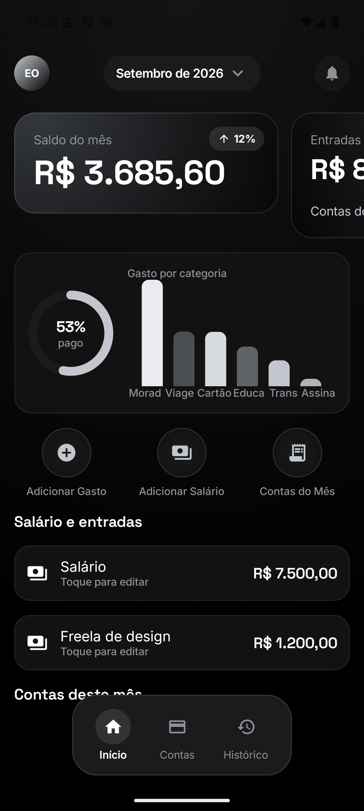
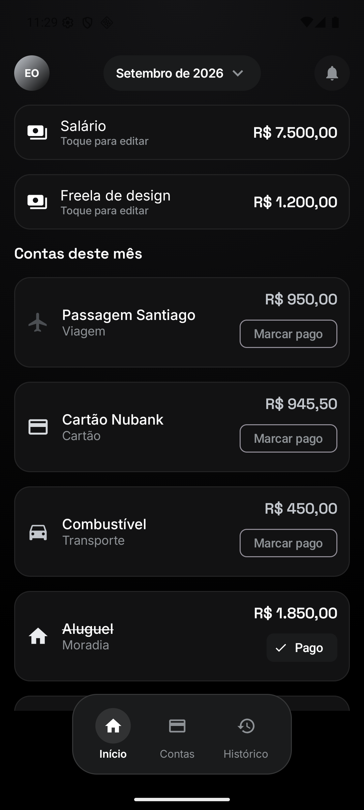
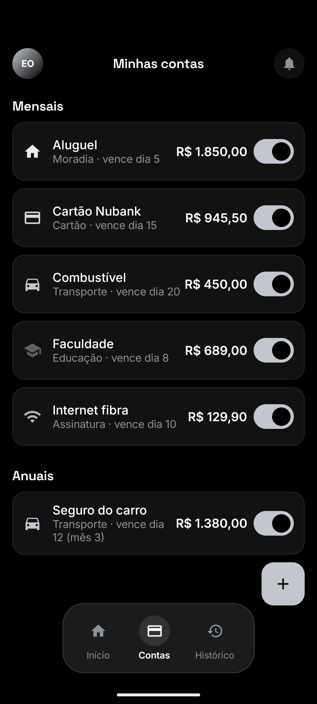
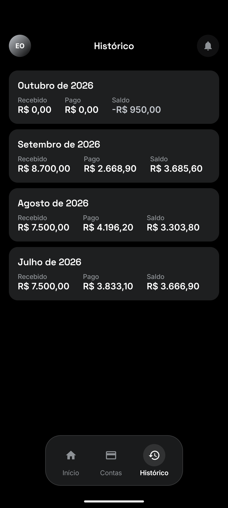
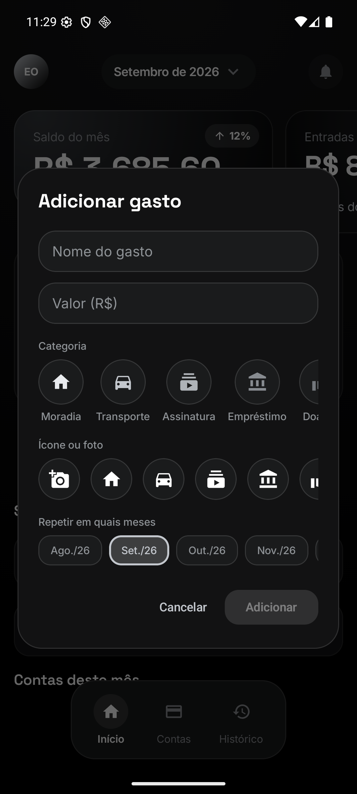
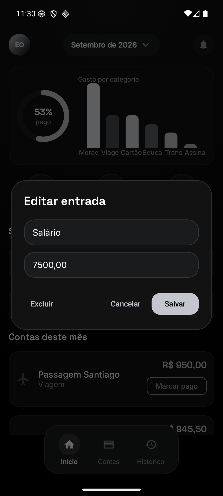

# Cofre

Controle financeiro pessoal para Android. Cadastre suas contas recorrentes uma vez,
registre o que entra, e acompanhe mês a mês o que já foi pago e quanto sobra.

**100% offline.** Nenhum dado sai do aparelho — não há login, servidor, nuvem ou
permissão de internet. Tudo fica num banco SQLite local.

<p align="center">
  
  
  
</p>

---

## Baixar

O APK está na aba **[Releases](../../releases/latest)** — baixe, abra no celular e
autorize a instalação de fontes desconhecidas quando o Android pedir.

Requer **Android 8.0 (API 26)** ou superior.

---

## O que ele faz

### Tela inicial


- **Saldo do mês** em destaque, com a variação percentual em relação ao mês anterior
- **Carrossel** deslizando para o lado: saldo e entradas
- **Medidor circular** com o percentual das contas do mês já pago
- **Gráfico de barras** por categoria, desenhado em `Canvas` (sem biblioteca externa)
- **Seletor de mês** no topo — navegue para qualquer mês, passado ou futuro
- **Salário e entradas**: toque em qualquer linha para editar ou excluir
- **Contas do mês**: toque em "Marcar pago" para quitar, ou na linha para editar

<br clear="right">

### Contas do mês


Cada conta recorrente cadastrada aparece automaticamente no mês, sem você precisar
lançar de novo. Contas pagas ficam riscadas e deixam de contar no saldo pendente.

O nome, o valor e a categoria são um **snapshot**: renomear ou mudar o valor de uma
conta recorrente não reescreve o histórico dos meses já fechados.

<br clear="right">

### Minhas contas


Onde ficam as contas recorrentes, separadas em **mensais** e **anuais**. O
interruptor pausa uma conta sem apagar o histórico dela — útil para uma assinatura
que você cancelou mas quer manter nos meses anteriores.

Contas anuais só são sugeridas no mês de vencimento configurado.

<br clear="right">

### Histórico



Um resumo por mês: quanto entrou, quanto foi efetivamente pago e o saldo. Meses
futuros já aparecem com as contas agendadas — no print, outubro já mostra a
passagem lançada para dois meses.

<br clear="right">

### Lançar um gasto



- **Categoria** entre nove opções (Moradia, Transporte, Assinatura, Empréstimo,
  Doação, Educação, Cartão, Viagem, Outro)
- **Ícone personalizado** de uma biblioteca de 20, ou **uma foto sua** escolhida da
  galeria — ela é reduzida para 512 px e guardada no armazenamento interno do app
- **Repetir em quais meses**: marque vários meses de uma vez. Uma dívida de três
  parcelas é lançada uma vez e aparece sozinha nos três meses

<br clear="right">

### Editar o que já foi lançado



Nada fica travado depois de cadastrado. Salário, entradas avulsas, contas do mês e
contas recorrentes — todos abrem um diálogo de edição com a opção de excluir.

<br clear="right">

---

## Como os dados são guardados

Quatro tabelas no Room (SQLite):

| Tabela | Para quê |
|---|---|
| `recurring_bills` | O molde: uma conta que se repete (nome, categoria, valor padrão, mensal/anual, dia de vencimento) |
| `month_bill_entries` | A ocorrência: aquela conta naquele mês, com o valor real e o status de pago |
| `monthly_incomes` | Salário e outras entradas, por mês |
| `transactions` | Tabela legada, preservada pelas migrações |

Dois detalhes que evitam dor de cabeça:

- **Dinheiro é `Long`, em centavos.** Nunca `Double` — `0.1 + 0.2` não é `0.3` em
  ponto flutuante, e num app de dinheiro isso vira centavo perdido.
- **As migrações nunca apagam nada.** Cada versão do banco tem uma `Migration`
  explícita (`1→2`, `2→3`) que só cria tabelas ou adiciona colunas. Atualizar o app
  não custa o seu histórico.

---

## Stack

- **Kotlin** + **Jetpack Compose** (Material 3)
- **Room** para persistência, com **KSP** para geração de código
- **StateFlow** + `ViewModel`, coletados com `collectAsStateWithLifecycle`
- Gráficos desenhados à mão em `Canvas` — sem biblioteca de charts
- Tipografia: **Space Grotesk** (números e títulos) e **Inter** (texto), como fontes
  variáveis carregadas via `FontVariation`
- Nenhuma dependência de rede, analytics ou terceiros

### Decisões de performance

Uma versão anterior tinha animações contínuas (névoa colorida nos cards e nos ícones
do menu). Elas consumiam **~40% de CPU com o app parado** e chegavam a travar a
interface. Foram removidas: hoje o app desenha **zero quadros quando está ocioso**.

As fotos das contas são reduzidas a 512 px na hora de salvar e mantidas num
`LruCache`. Decodificar uma foto de 12 MP em resolução total custa ~48 MB de RAM
para exibir num círculo de 40 dp — e derrubava o app ao rolar a lista.

---

## Rodando o projeto

Requer **JDK 17** e o **Android SDK** (plataforma 34).

```bash
git clone https://github.com/edusoliveira/cofre.git
cd cofre
```

Crie um `local.properties` na raiz apontando para o seu SDK (use barras normais,
mesmo no Windows):

```properties
sdk.dir=C:/Users/SEU_USUARIO/AppData/Local/Android/Sdk
```

Depois:

```bash
./gradlew assembleDebug
```

O APK sai em `app/build/outputs/apk/debug/app-debug.apk`. Para instalar direto num
aparelho ou emulador conectado:

```bash
./gradlew installDebug
```

### Espelhar o aparelho na tela do computador

Os scripts em `scripts/` sobem o emulador e abrem o [scrcpy](https://github.com/Genymobile/scrcpy)
já apontado para ele, útil para ver as mudanças enquanto desenvolve:

```bash
./scripts/live-preview.sh
```

No Windows há também `live-preview.bat` e `live-preview.ps1`.

---

## Estrutura

```
app/src/main/java/io/edusoliveira/meudia/
├── data/
│   ├── db/
│   │   ├── entities/      # RecurringBill, MonthBillEntry, MonthlyIncome
│   │   ├── dao/           # consultas Room
│   │   └── AppDatabase.kt # versão do banco e migrações
│   └── FinanceRepository.kt
├── ui/
│   ├── finance/           # as três telas e os diálogos
│   │   └── components/    # cards, medidor, gráfico de barras
│   ├── navigation/        # menu inferior
│   ├── theme/             # paleta preto/prata e tipografia
│   └── components/        # barra superior, seletor de mês
└── util/                  # dinheiro, datas, imagens
```

---

## Créditos

As fontes incluídas em `app/src/main/res/font/` são de terceiros, distribuídas sob a
[SIL Open Font License 1.1](https://openfontlicense.org/):

- **[Inter](https://github.com/rsms/inter)** — Rasmus Andersson
- **[Space Grotesk](https://github.com/floriankarsten/space-grotesk)** — Florian Karsten
